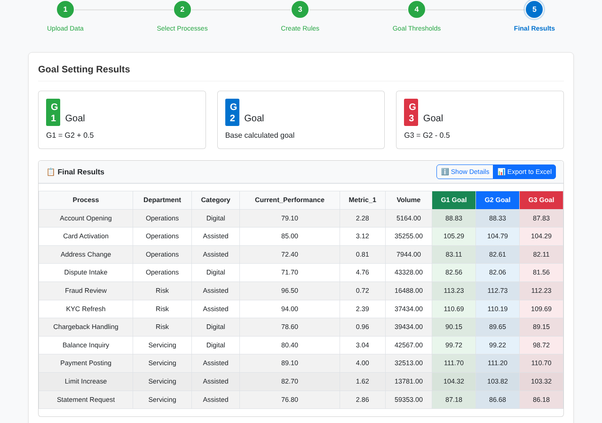
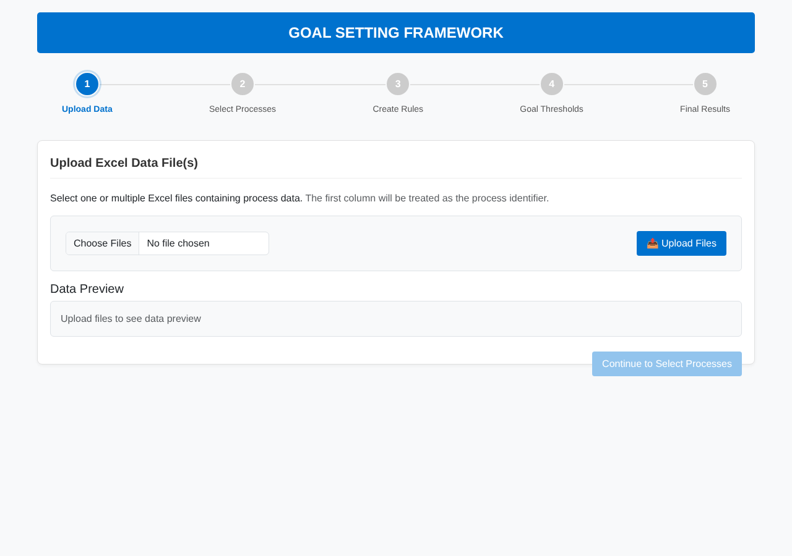
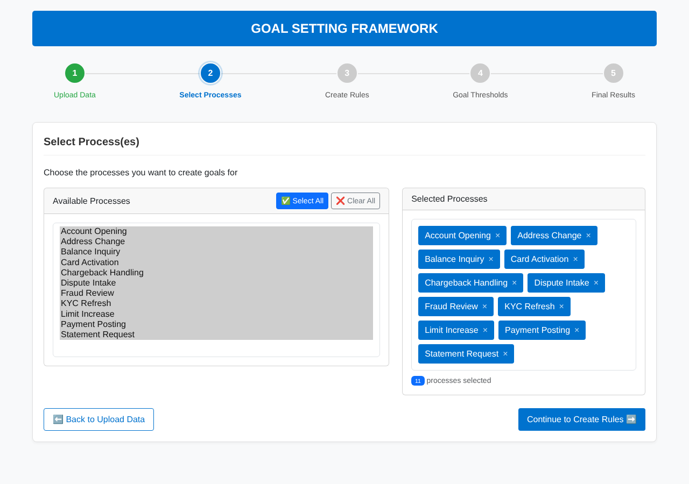
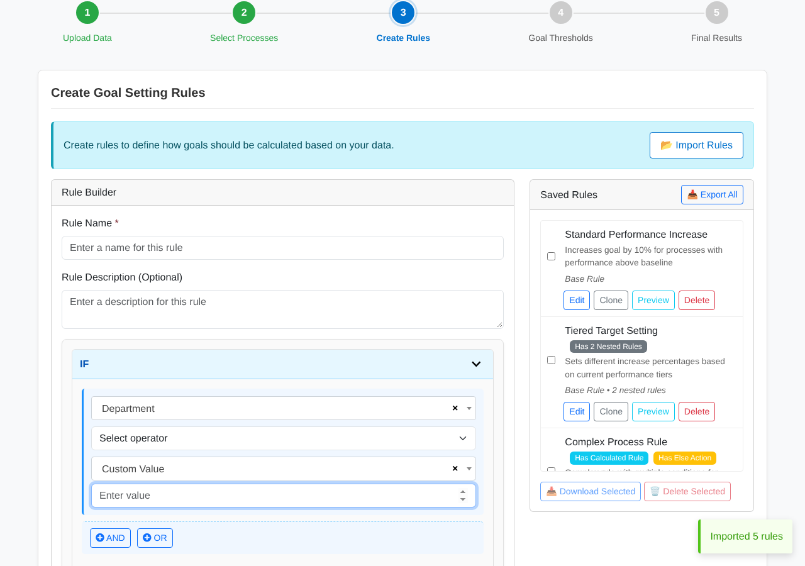
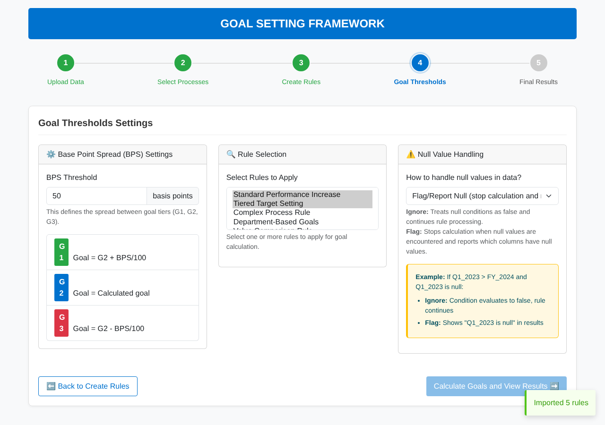

# 🎯 Goal Setting Tool: Rule-Based Multi-Tier Goal Calculator

A **browser-only** tool that turns process performance data from Excel into **three tiers of goals (G1 / G2 / G3)** using business rules you build with a visual IF / AND / OR / ELSE editor. It needs no server and no install, and works fully offline because every library is bundled.

> Built to replace a manual spreadsheet process for setting operational performance targets across many processes.



---

## ✨ Features

- **Excel in, Excel out.** Upload one or more `.xlsx` files (parsed in the browser with SheetJS) and export results with metadata.
- **Visual rule builder.** Nested conditions (`AND` / `OR`), `ELSE` branches, column-to-column or column-to-value comparisons.
- **Rich actions.** Set a value, add, subtract, multiply, divide, percentage increase or decrease, reset, or a custom calculation.
- **Multi-tier goals.** G2 is the calculated base goal. G1 and G3 are offset by a configurable **basis-point spread**.
- **Rule library.** Save, clone, preview, import and export rules as JSON so they can be shared across teams. Rules live in memory, so export them to keep them between sessions.
- **Null handling.** Choose how blank cells behave during calculation.
- **Offline-ready.** Bootstrap, jQuery, Select2, SheetJS, JSZip and Font Awesome are vendored in `css/`, `js/` and `fonts/`.

## 🚀 Try it in 60 seconds

```bash
git clone https://github.com/vijay2834/Test_tool_5.git
cd Test_tool_5
open index.html            # or double-click it, or: python -m http.server
```

1. **Upload data**: use [`examples/sample_process_data.xlsx`](examples/sample_process_data.xlsx).
2. **Select processes**: click *Select All*.
3. **Create rules**: click *Import Rules* and pick [`sample.json`](sample.json) (5 example rules), or build your own.
4. **Goal thresholds**: pick the rules to apply and set the BPS spread (default 50 bps).
5. **Results**: review G1, G2 and G3, then *Export to Excel*.

| 1 · Upload | 2 · Select processes |
|---|---|
|  |  |
| **3 · Build / import rules** | **4 · Thresholds** |
|  |  |

## 📄 Input format

The first column is treated as the **process name**. Every other column can be used in rules. The sample file uses:

| Process | Department | Category | Current_Performance | Metric_1 | Volume | G2_goal |
|---|---|---|---|---|---|---|
| Account Opening | Operations | Digital | 79.1 | 2.28 | 5164 | 81.4 |

Date headers stored as Excel serial numbers are converted to month labels automatically.

## 🧩 Rule JSON format

```json
{
  "name": "Standard Performance Increase",
  "rule": {
    "baseRule": {
      "condition": { "leftColumn": "Current_Performance", "operator": ">", "rightType": "value", "rightValue": "80" },
      "action":    { "column": "G2_goal", "type": "percent-increase", "value": "10" },
      "nestedRules": [],
      "elseAction": null
    }
  }
}
```

## 🏗️ Code structure

```
index.html              5-step wizard UI
js/app.js               bootstraps modules and step navigation
js/data-handler.js      Excel parsing, multi-file merge, date-header handling
js/rule-builder.js      visual IF/AND/OR/ELSE editor
js/rule-storage.js      save, clone, preview, import and export the rule library (JSON)
js/goal-processor.js    evaluates rules row by row and computes G1/G2/G3 with the BPS spread
js/visualization.js     results table and details view
js/ui-components.js     toasts, modals, helpers
download_offline.py     re-downloads vendored libraries if you want to update them
```

## 🛠️ Tech stack

HTML5 · CSS3 · vanilla JavaScript (ES6) · Bootstrap 5 · jQuery · Select2 · SheetJS · JSZip

## 🗺️ History

This is v2 of the tool. The original single-file prototype lives in [`g_tool`](https://github.com/vijay2834/g_tool).
